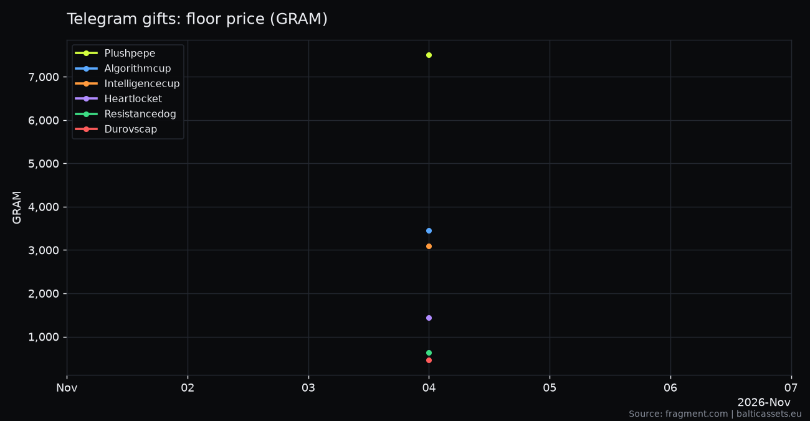
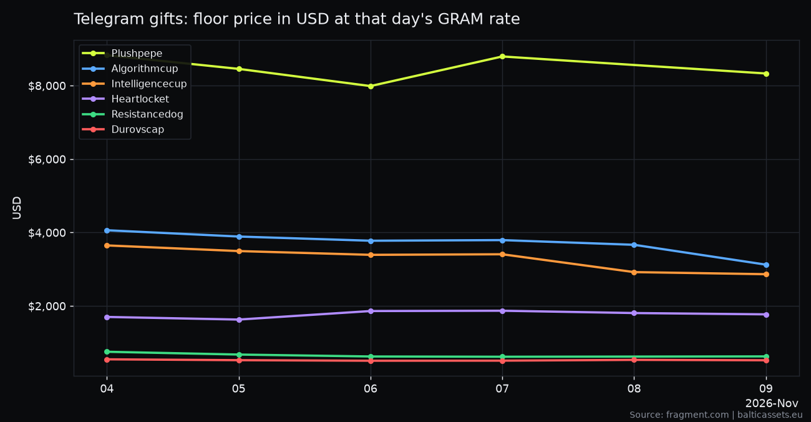

# Telegram gifts floor price: daily open dataset

Floor prices of every Telegram NFT gift collection (Plush Pepe, Durov's Cap, Lol Pop and 120 more),
collected **once a day** from [fragment.com](https://fragment.com/gifts), the official gift marketplace.
One CSV, one row per collection per day, prices in GRAM (the coin formerly called TON).

Updated automatically by GitHub Actions. First measurement: **4 Nov 2026**, 123 collections.

- Data: [`data/floor_prices.csv`](data/floor_prices.csv) (full history), [`data/rates.csv`](data/rates.csv) (daily GRAM rate in USD and EUR), [`data/latest.json`](data/latest.json) (today's floors)
- Live tool with rarity and a net-profit calculator: [Telegram Gifts checker on Baltic Assets](https://balticassets.eu/en/crypto/telegram-gifts/)

## Charts

Redrawn every Monday from the full history. The second chart converts each day's floor at that day's
GRAM/USD rate (from [tonapi.io](https://tonapi.io), stored in `data/rates.csv`), so you can see how much of a
move is the gift and how much is the coin.





Charts are single-point until more days are collected; they fill in as the history grows.

## Columns

| Column | Meaning |
|---|---|
| `date` | measurement day, UTC (`YYYY-MM-DD`) |
| `collection` | collection slug as on Fragment (`plushpepe`, `durovscap`, `lolpop`) |
| `floor_gram` | cheapest lot for sale, in GRAM. **Can be an auction price** |
| `floor_fixed_gram` | cheapest **fixed-price** lot. Empty if all lots seen were auctions |
| `lots_seen` | lots counted on the first page of listings (Fragment shows at most 60) |
| `auctions_seen` | how many of those lots are auctions |

Why two floors: Fragment mixes fixed-price lots and running auctions in one list. On 4 Nov 2026 every
cheapest Plush Pepe lot was an auction, so there is no fixed-price floor for it that day. `lots_seen` is
capped at 60 and is **not** the total number of listed gifts.

## Sample (4 Nov 2026, highest floors)

| collection | floor_gram | floor_fixed_gram | lots_seen | auctions_seen |
|---|---|---|---|---|
| plushpepe | 7500 | | 60 | 60 |
| algorithmcup | 3450 | 3450 | 13 | 0 |
| intelligencecup | 3099 | 3099 | 8 | 0 |
| heartlocket | 1444 | 1444 | 38 | 0 |
| resistancedog | 638 | 638 | 60 | 0 |

## Use it

```python
import pandas as pd
df = pd.read_csv("https://raw.githubusercontent.com/Atlannn/telegram-gifts-floor-price/main/data/floor_prices.csv")
df[df.collection == "plushpepe"].plot(x="date", y="floor_gram")
```

## JSON API

The same data as a free static JSON API on GitHub Pages: no key, CORS enabled, rebuilt after every daily run.

```
https://atlannn.github.io/telegram-gifts-floor-price/api/v1/index.json
https://atlannn.github.io/telegram-gifts-floor-price/api/v1/latest.json
https://atlannn.github.io/telegram-gifts-floor-price/api/v1/collections/plushpepe.json
```

Floors come in GRAM, USD and EUR. Details: [API page](https://atlannn.github.io/telegram-gifts-floor-price/).
Rebuild locally with `python build_api.py` (writes `docs/api/v1/`).

## Collect it yourself

```bash
python collect.py                 # all collections, ~3 minutes, standard library only
python collect.py plushpepe lolpop
```

Re-running on the same day replaces that day's rows. The script waits 1 second between requests and sends
an identifying User-Agent. Collections with nothing for sale get no row.

## Notes

- Prices are in **GRAM**. Fragment still labels them "TON"; Telegram renamed the coin on 15 Jun 2026.
- A floor is an asking price, not a sale price. Fees (Telegram takes 10% for GRAM sales, Fragment about
  5% plus a network fee) are not included.
- Source is fragment.com only. Other marketplaces (Tonnel, Portals, MRKT) price differently and are not covered.

## License

Code: MIT. Data: CC BY 4.0, credit "Telegram gifts floor prices, Baltic Assets" with a link to
https://balticassets.eu.
